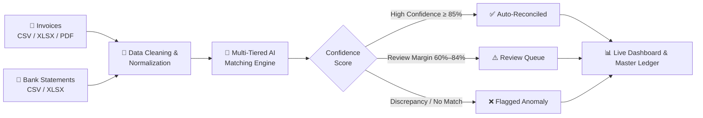

<div align="center">


[](#-hackathon)
[](#-how-it-works)
[](#-quick-start)
[](LICENSE)


**Stop matching invoices to payments by hand. Let AI do it in seconds.**

[🎥 Demo Video](#-demo-video) • [📸 Screenshots](#-screenshots) • [🧠 How It Works](#-how-it-works) • [✨ Key Features](#-features) • [💻 Desktop Architecture](#-desktop-application-architecture) • [⚙️ Quick Start](#-quick-start) • [👥 Team Griphers](#-team-griphers)

</div>

---

## 📌 The Problem

Finance and accounting teams spend countless hours every week manually matching invoices against bank payment statements. Discrepancies constantly arise from:
- Minor amount variances, partial payments, and split settlements across multiple invoices.
- Missing, mistyped, or truncated customer reference codes and bank descriptions.
- Duplicate invoices and phantom payments slipping through manual reviews.
- Outdated month-end closes that lead to human error and cash-flow blind spots.

---

## 💡 Our Solution

**FinRecon AI (GRIPHER)** is an intelligent, automated financial reconciliation platform engineered for Windows 10/11 desktops and enterprise deployment. It pairs invoices with bank payments using AI-powered fuzzy entity matching, amount-tolerance heuristics, and transaction date proximity, while isolating edge cases for human-in-the-loop review.

> **Ingest invoices & bank feeds** ➔ **AI engine matches & scores confidence** ➔ **Resolve only flagged exceptions with 1-click audit trail.**

---

## ✨ Features

| | Feature | Description |
|---|---|---|
| 🤖 | **AI-Powered Matching Engine** | Pairs invoices and payments even with mistyped names, partial amounts, or fuzzy reference numbers using RapidFuzz and multi-tiered scoring. |
| 🔍 | **Discrepancy & Anomaly Detection** | Flags overpayments, underpayments, duplicates, unusual amounts, and currency mismatches instantly. |
| 📊 | **Real-Time KPI Dashboard** | Executive metrics: total value, inflows, reconciled percentage, unreconciled aging, and visual Chart.js analytics. |
| 📁 | **Multi-Format Ingestion** | Seamlessly imports CSV, Excel (`.xlsx`, `.xls`), and PDF invoices (layout-aware text extraction with OCR fallback). |
| 🛡️ | **Credit vs. Debit Segregation** | Bank debit amounts (fees, transfers) are strictly excluded from reconciliation candidates. |
| 🎯 | **Transparent Confidence Scores** | Granular AI confidence scores with full mathematical justification for audit compliance. |
| ⚖️ | **Partial & Split Payment Allocation** | Allocates single payments across multiple invoices or multiple installments against one invoice. |
| 📤 | **Enterprise Report Generation** | Generates multi-tab Excel workbooks (`.xlsx`) and print-ready vector PDF financial audit statements. |

---

## 🎥 Demo Video

> 🎬 **Watch the full application walkthrough and demo:**

[▶ Click here to open and watch the demo video (`uploads/Sample Video.mp4`)](uploads/Sample%20Video.mp4)

---

## 📸 Screenshots

<div align="center">

| 📊 Dashboard Overview | ⚡ Reconciliation Results |
|:---:|:---:|
| <a href="uploads/Dashboard%20Overview.png"></a> | <a href="uploads/Reconciliation%20Result.png"></a> |
| *Real-time KPIs, aging buckets, cash flows & reconciliation progress* | *AI matching candidates with confidence scores and action controls* |

<br/>

| 🔍 Mismatch & Discrepancy Review | 📑 Reports & Master Ledger Export |
|:---:|:---:|
| <a href="uploads/Mismatch%20Review.png"></a> | <a href="uploads/Reports%20&%20Export.png"></a> |
| *Automated anomaly detection: duplicates, overdue & unusual amounts* | *Comprehensive audit reports exported directly to Excel and PDF* |

</div>

---

## 🧠 How It Works



1. **Ingest & Cleanse**: Parses invoices and bank statements with automated column alias detection and debit/credit segregation.
2. **Normalize & Safeguard**: Converts all currency figures into integer minor units (cents) to eliminate floating-point drift; blocks cross-currency mismatches.
3. **Multi-Signal Matching**: Evaluates exact reference numbers, RapidFuzz vendor entity similarity, amount proximity, and issuance-to-payment date windows.
4. **Scoring & Allocation**: Computes transparent confidence scores; executes ACID atomic ledger allocations with overpayment protection.
5. **Human-in-the-Loop Review**: Surfaces flagged exceptions with detailed explanations for 1-click approval, rejection, or manual splits.

---

## 🛠️ Tech Stack

| Layer | Technologies |
|---|---|
| **Desktop Shell** | Python 3.11+ / PySide6 (Qt for Python), QWebEngineView, Windows Mutex Lock |
| **Backend API** | FastAPI, Uvicorn, Pydantic v2 |
| **Database & Ledger** | SQLite with ACID transactions, SQLAlchemy 2.0 ORM |
| **AI & Matching Engine** | RapidFuzz (token sort & ratio similarity), integer-cent arithmetic engine |
| **File Parsers** | OpenPyXL (Excel), Python CSV engine, pypdf & PyMuPDF (PDF invoices) |
| **Document Generation** | ReportLab (Vector PDF generator), OpenPyXL (Multi-sheet styled workbooks) |
| **Frontend UI** | Jinja2 templates, Bootstrap 5 (Dark Fintech Theme), Chart.js, Feather Icons |
| **Packaging & CI** | PyInstaller standalone packaging (`Gripher.exe`), PowerShell verification scripts |

---

## 💻 Desktop Application Architecture

```
+-------------------------------------------------------------------+
|                        GRIPHER.EXE (PySide6)                      |
|                                                                   |
|   +-----------------------+     +-------------------------------+ |
|   |   desktop_run.py      |     |  Single-Instance Mutex Lock   | |
|   +-----------+-----------+     +-------------------------------+ |
|               |                                                   |
|   +-----------v-----------+     +-------------------------------+ |
|   |  desktop/app.py       |---->|  Dynamic Free Port Allocator  | |
|   +-----------+-----------+     +-------------------------------+ |
|               |                                                   |
|   +-----------v-----------+     +-------------------------------+ |
|   | desktop/splash.py     |---->|  Splash Screen & Health Check | |
|   +-----------+-----------+     +-------------------------------+ |
|               |                                                   |
|   +-----------v-----------+     +-------------------------------+ |
|   | desktop/server_thread |---->|  Uvicorn FastAPI Server       | |
|   +-----------+-----------+     |  (Bound to 127.0.0.1:port)     | |
|               |                 +---------------+---------------+ |
|               |                                 |                 |
|   +-----------v---------------------+           |                 |
|   | desktop/main_window.py          |           |                 |
|   | (PySide6 QWebEngineView Window) <-----------+                 |
|   +---------------------------------+                             |
|                                                                   |
|   +-------------------------------------------------------------+ |
|   | Storage: %LOCALAPPDATA%\Gripher\finrecon.db (ACID SQLite)   | |
|   +-------------------------------------------------------------+ |
+-------------------------------------------------------------------+
```

---

## ⚙️ Quick Start

### Option 1: Standalone Windows App (`Gripher.exe`)
1. Download or locate `dist\Gripher\Gripher.exe`.
2. Double-click to launch. The app initializes the local embedded SQLite database and launches the desktop interface.
3. Default login credentials:
   - **Username**: `admin`
   - **Password**: `admin123`

---

### Option 2: Run in Development Mode
Requires Python 3.11+.

```powershell
# 1. Clone repository
git clone https://github.com/dakshcrafts/FinRecon-AI.git
cd FinRecon-AI

# 2. Automated dev launcher (creates venv, installs requirements, launches desktop app)
.\scripts\run_dev.ps1
```

Or manually:
```powershell
python -m venv .venv
.\.venv\Scripts\Activate.ps1
pip install -r requirements.txt
python desktop_run.py
```

To run purely as a local web service (in your browser without PySide6):
```powershell
uvicorn app.main:app --host 127.0.0.1 --port 8000 --reload
```
Then navigate to `http://127.0.0.1:8000`.

---

## 🧪 Automated Test Suite

Run the full automated test suite covering API routes, parsers, reconciliation edge cases, and desktop smoke tests:

```powershell
.\scripts\run_tests.ps1
```

Or using `pytest`:
```powershell
pytest -v tests/
```

### Test Coverage Highlights:
- `tests/test_api_and_parsers.py`: Invoices/payments CRUD, CSV/Excel parser alias matching, duplicate checks, audit logging.
- `tests/test_reconciliation.py`: Exact matching, RapidFuzz entity similarity, partial payments, split payments, multi-currency prevention, integer minor cents precision.
- `tests/test_desktop_smoke.py`: Dynamic port allocator, single-instance mutex, database backup and reset, desktop initialization.

---

## 🔨 Building the Windows Executable

To build the standalone Windows binary:

```powershell
.\scripts\build_windows.ps1
```

Verify build integrity:
```powershell
.\scripts\verify_build.ps1
```

Output binary:
`dist\Gripher\Gripher.exe`

---

## 📂 Project Structure

```
FinRecon-AI/
├── uploads/                   # Banner, footer, screenshots & demonstration video
│   ├── banner.svg
│   ├── footer.svg
│   ├── Dashboard Overview.png
│   ├── Mismatch Review.png
│   ├── Reconciliation Result.png
│   ├── Reports & Export.png
│   └── Sample Video.mp4
├── app/
│   ├── models/                # SQLAlchemy ORM models (Invoice, Payment, Reconciliation, Anomaly)
│   ├── routers/               # FastAPI controllers (Dashboard, Review, Discrepancies, etc.)
│   ├── schemas/               # Pydantic validation schemas
│   ├── services/              # Domain logic
│   │   ├── reconciliation_engine.py  # Precision integer-cent AI matching engine
│   │   ├── anomaly_service.py        # Discrepancy & fraud detection rules
│   │   ├── outstanding_service.py    # Accounts receivable aging schedule
│   │   ├── invoice_parser.py         # CSV, Excel, PDF parser
│   │   ├── payment_parser.py         # Bank statement parser with credit/debit segregation
│   │   ├── report_generator.py       # Excel and PDF report generation
│   │   └── audit_service.py          # Compliance audit trail
│   ├── static/                # Dark theme CSS, JS, Chart.js
│   ├── templates/             # Jinja2 HTML templates
│   ├── database.py            # SQLite connection, migration, backup, demo-reset
│   └── main.py                # FastAPI app initialization
├── desktop/                   # Native PySide6 Desktop Shell
│   ├── app.py                 # Application lifecycle, mutex, port allocation
│   ├── splash.py              # Splash screen with server health polling
│   ├── server_thread.py       # Controlled Uvicorn background thread
│   └── main_window.py         # PySide6 desktop window (QWebEngineView)
├── packaging/
│   └── gripher.spec           # PyInstaller build specification
├── sample_files/              # Realistic invoices, bank statements, and edge cases
├── scripts/
│   ├── run_dev.ps1            # Development runner
│   ├── run_tests.ps1          # Automated test execution
│   ├── build_windows.ps1      # PyInstaller packaging script
│   └── verify_build.ps1       # Executable verification script
├── tests/                     # Automated unit and integration test suite
├── desktop_run.py             # Desktop launcher entry point
├── requirements.txt           # Python dependencies
└── README.md                  # Project documentation
```

---

## 🚀 Roadmap

- [ ] Direct bank & accounting integrations (Tally, QuickBooks, Zoho Books)
- [ ] Automated payment reminders & supplier email dispatch
- [ ] Active reinforcement learning from accountant overrides
- [ ] Multi-tenant organization support with enterprise SAML SSO

---

## 🏆 Hackathon

Built at **ARCHITHON** by **Team Griphers** · Theme: FinTech / AI (PS02 – Invoice & Payment Reconciliation)

## 👥 Team Griphers

| Member | Role | GitHub |
|---|---|---|
| **Daksh Sharma** | 👑 Team Leader | [@dakshcrafts](https://github.com/dakshcrafts) |
| **Sachin** | Team Member | [@sharmasachinbharadwaj-del](https://github.com/sharmasachinbharadwaj-del) |
| **Rohan** | Team Member | [@rohan78950-debug](https://github.com/rohan78950-debug) |
| **Diya** | Team Member | — |

---

<div align="center">

⭐ If you find FinRecon AI useful, please consider giving it a star on GitHub!


</div>
